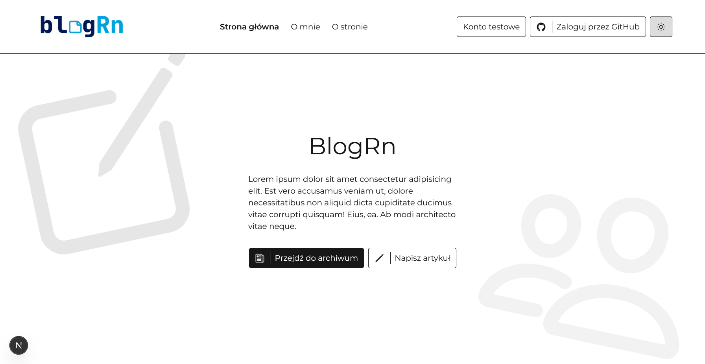
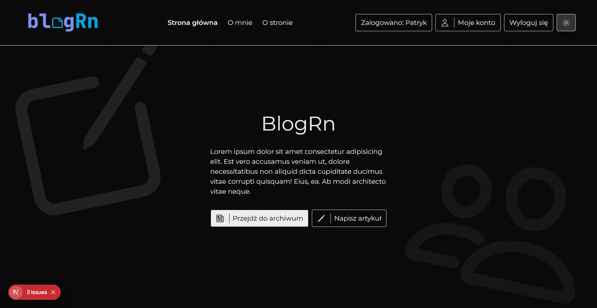
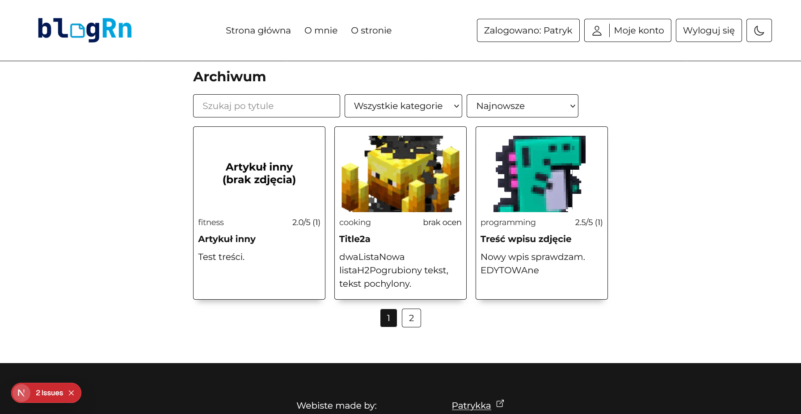
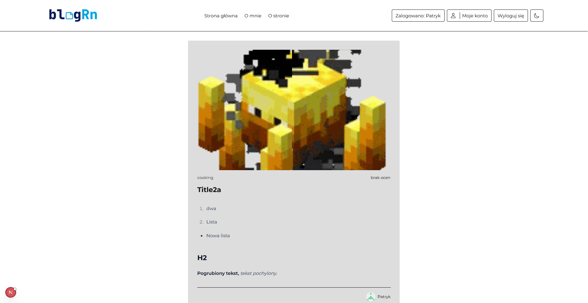
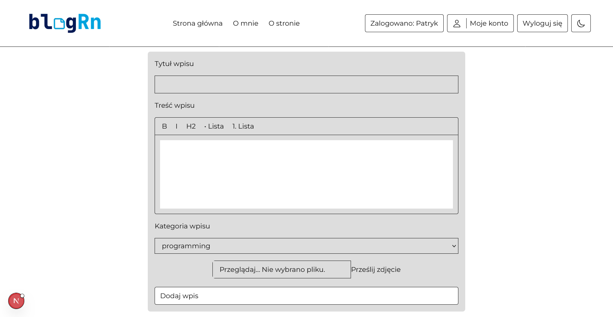
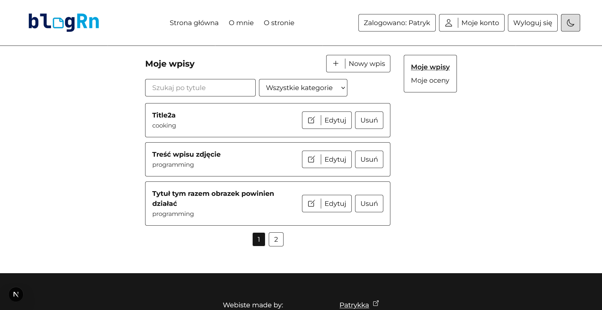

## Getting Started

### Set variables in `.env` and `.env.docker` (just remove `.example` from filename)

### Remove ".example" part in:

- `.env.example`
- `.env.docker.example`

...and fill it with valid data.

### Run `docker compose up -d` to run local containers

### Run `pnpm drizzle-kit push` to synchronize tables with db.

### Run the development server

```bash
npm run dev
# or
yarn dev
# or (preferred)
pnpm dev
# or
bun dev
```

### Open [http://localhost:3000](http://localhost:3000).

## Info

- I used `Next.js`  to create and manage an app.

- I used `postgreSQL`  as the database.

- I used `Git`  and `GitHub`  for version control.

- I used `Docker`  to containerize app.

- I used  `Tailwind CSS` for easy and modern UI.

## Features

- Authorization, authentication
- Image server (uploadthing) with <Image> optimalization
- User dashboard with
  - Users Reviews list (no sort and filter tho)
  - Users blogs
- Dark and light theme on client side
- Static websies
  - Homepage (Strona główna)
  - About me page (O mnie)
  - About app (O stronie)

## Screenshots

### Homepage (light + dark mode)




Don't mind errors just like I do. (do the "lalala don't see it" technique).

### Articles (archive, single, add/edit)





Single archive is zoomed to 70% to fit in the screenshot.

### Dashboard (users' articles + ratings)


